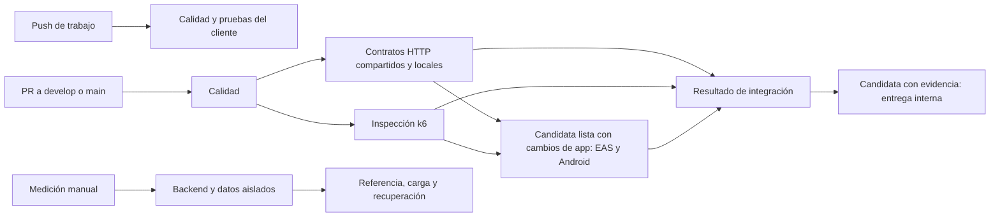

# Sport Center Mobile

Aplicación móvil de Sport Center para consultar productos deportivos y acceder a los servicios de la tienda.

Desarrollada con Expo SDK 57, React Native, TypeScript y Expo Router.
Repositorio: [Markadw/SportCenter-mobile](https://github.com/Markadw/SportCenter-mobile).

## Estado del proyecto

El proyecto está en desarrollo. La base disponible incluye inicio, catálogo, filtros por categoría y marca, y detalle de producto con consumo del backend.

La infraestructura de pruebas cubre lógica, componentes e integración del cliente con transporte simulado. Autenticación permanece pendiente de integración. Carrito, direcciones, compra/pago, historial y gestión de datos personales forman parte del desarrollo pendiente. El alcance y los responsables se consultan en el [tablero personal](https://github.com/users/Markadw/projects/2).

## Entorno y arranque

Usar Node 22.20.0 o superior compatible con SDK 57 y npm. Desde la carpeta del proyecto:

```powershell
npm ci
npm start
```

Escanear con Expo Go el QR que muestre esa terminal. Mantener el teléfono y la PC en la misma red y la terminal abierta. La dirección de Metro corresponde a la conexión de esa ejecución. Para limpiar su caché: `npm start -- --clear`.

La API predeterminada es https://back-sport-ghxk.onrender.com. Para cambiarla, copiar `.env.example` a `.env.local` y definir `EXPO_PUBLIC_API_URL`. Recargar completamente la aplicación después del cambio. Los valores EXPO_PUBLIC_ son públicos en el bundle; no guardar secretos allí.

Instalar paquetes con `npx expo install <paquete>` para resolver versiones compatibles con el SDK. Las carpetas android/ e ios/ se generan con Expo; la configuración nativa se mantiene mediante app.json y plugins.

## Verificación

```powershell
npm run validate
npx expo-doctor
```

- `npm run lint`: revisión ESLint del proyecto.
- `npm run typecheck`: comprobación TypeScript sin generar JavaScript.
- `npm run lint:report` y `npm run typecheck:report`: ejecutan los analizadores instalados con la configuración del proyecto y guardan sus informes en `test-results/static-analysis/`.
- `npm run validate`: ejecuta lint, TypeScript, pruebas del cliente con cobertura y validación de configuración; se detiene ante un fallo.

La validación del cliente usa transporte HTTP simulado. No consulta la API desplegada ni ejecuta aceptación Android o carga. El empaquetado de JavaScript tampoco equivale a generar un APK firmado.

### Pruebas

| Comando | Alcance |
| --- | --- |
| `npm test` | Pruebas Jest del cliente |
| `npm run test:unit` | Lógica y componentes en __tests__/ |
| `npm run test:integration` | Integración de vistas, contextos y servicios con transporte simulado |
| `npm run test:ci` | Jest con cobertura y reporte JSON en test-results/ |
| `npm run test:config` | Coherencia de workflows, flujos Maestro, perfil EAS y plan de pruebas |
| `npm run test:api` | Contratos HTTP reales de lectura; requiere API_BASE_URL explícita |
| `npm run env:start` / `npm run env:stop` | Preparar o detener backend y datos sintéticos locales |
| `npm run test:performance -- all` | Referencia, carga y esfuerzo en la copia local |

Para ejecutar las consultas HTTP públicas desde PowerShell:

```powershell
$env:API_BASE_URL = 'https://back-sport-ghxk.onrender.com'
npm run test:api
```

La suite HTTP consulta catálogo, detalle y rechazo del perfil sin sesión; no crea cuentas ni modifica datos. Los resultados de cada ejecución se distinguen de la preparación de sus scripts.

Los flujos Maestro de catálogo y detalle se ejecutan sobre un APK candidato en un emulador Android API 34 de GitHub. Un PR en borrador ejecuta calidad e integración sin generar APK. Al marcarlo listo, Android es obligatorio si cambia la aplicación, dependencias, compilación o flujos de aceptación; también es obligatorio para entregas a main. Un PR sólo de informes, pruebas de herramientas o documentación no recompila; después de un merge a develop se ejecuta regresión del cliente y HTTP sin repetir Android. La ejecución manual permite incluir Android en develop. Un fallo de calidad o HTTP impide compilar y ejecutar aceptación.

Los guiones k6 de rendimiento y estrés requieren una API propia aislada y un commit de backend identificado. No ejecutarlos contra el Render compartido ni servicios de pago. Su inspección no equivale a medir capacidad o aprobar rendimiento.

### Matriz de automatización

| Evento | Rama o destino | Comprobaciones |
| --- | --- | --- |
| Push de trabajo | feature/*, fix/*, chore/*, test/*, release/*, hotfix/* | Calidad si no hay PR para ese commit; con PR se evita repetirla |
| PR en borrador | develop o main | Calidad, contratos HTTP e inspección k6; sin compilar APK |
| PR listo | develop o main | Lo anterior; Android para cambios de app/build/aceptación o entrega a main |
| Push integrado, incluido merge | develop | Calidad, contratos HTTP e inspección k6 |
| Push integrado, incluido merge | main | Calidad, contratos HTTP, inspección k6 y compilación/aceptación Android; conserva evidencia |
| Manual | develop, release/* o hotfix/* | Integración; Android opcional sólo en develop y obligatorio en candidatas |
| Medición manual | develop o ramas de trabajo | Referencia, carga y esfuerzo con backend y datos aislados en el runner |

El merge se atiende mediante push a su destino. No se añade un segundo disparador por cierre del PR. El resultado Resultado de integración falla si una etapa obligatoria falla, se cancela o se omite; en `develop` está marcada como requerida para integrar cambios. Los PR verifican la combinación con la base y los pushes verifican el commit de la rama. En una rama con PR abierto pueden aparecer dos eventos de GitHub: el push sólo consulta si el PR se hace cargo y omite el trabajo duplicado. No hay ejecuciones programadas ni reintentos automáticos de Android.

El resumen de calidad incluye versión, código de salida y diagnósticos de ESLint y TypeScript. TypeScript se ejecuta aunque ESLint falle para informar ambos resultados; las pruebas posteriores e integración continúan bloqueadas. Un informe ausente, de otra ejecución o de una etapa omitida se señala explícitamente. Los JSON se incluyen en el mismo `client-evidence`, sin añadir artefactos.

Las ejecuciones ordinarias publican resultados en el resumen y los logs, sin subir informes de pruebas. Se conservan paquetes compactos ante fallos, en PR hacia main, en main, en candidatas manuales y en PR marcados con la etiqueta `evidencia`. La etiqueta permite guardar una candidata concreta sin archivar cada push ordinario. Todos tienen retención de 14 días. Una simple inspección k6 no genera artefactos; una medición real conserva un único paquete con sus JSON y resumen. Los APK permanecen en EAS y no se duplican en los artefactos de GitHub.

Los reportes de GitHub Actions son evidencias de esas ejecuciones; los archivos históricos de evidence/ conservan su fecha y commit originales.

Una candidata con evidencia y aceptación Android aprobada se registra en el entorno `qa-interna` de GitHub después de `Resultado de integración`. La entrega reutiliza el enlace EAS y el SHA256 del mismo APK comprobado; no vuelve a compilarlo. Si una comprobación obligatoria falla o se omite, no se entrega la candidata. Este registro permite una instalación interna; no publica Google Play ni modifica ramas.




### Android comprobado en CI

La [última candidata Android comprobada](https://github.com/Markadw/SportCenter-mobile/actions/runs/40453688133), commit `ac6bf53`, aprobó 122 pruebas, cuatro contratos por entorno, dos recorridos Android y entrega interna. Las correcciones posteriores de política se comprueban sin generar otro APK mientras el PR esté en borrador.

El proyecto EAS es `anth.oi/sport-center-mobile` y el paquete Android es `com.markadw.sportcenter`. GitHub tiene configurado `EXPO_TOKEN`; las credenciales de firma se administran en EAS.

Como evidencia histórica, la [revisión de referencia edca463](https://github.com/Markadw/SportCenter-mobile/actions/runs/40435769513) aprobó calidad, 96 pruebas del cliente e infraestructura, cuatro contratos HTTP y dos recorridos Android. Su APK terminó en EAS y fue instalada en el emulador API 34. Estos resultados acreditan el incremento de catálogo y detalle básicos.

- `API_TEST_URL` elige el backend de los contratos y del APK; `API_TEST_PRODUCT_ID` fija el producto HTTP y `ANDROID_TEST_PRODUCT_NAME` el producto de Maestro.
- La preparación comprueba que la API responda y que Android tenga una red validada. Los flujos arrancan con estado limpio.
- EAS debe terminar el APK del commit comprobado. CI verifica procedencia y SHA256 antes de instalarlo.
- `preview` genera APK para distribución interna y `production` prepara AAB. La publicación en Google Play sigue pendiente.
- Las capturas y el informe Maestro se conservan ante fallos o cuando se solicita evidencia de una candidata; el APK permanece en EAS.

### Copia local del backend para pruebas

Requiere Docker Desktop en modo de contenedores Linux, Git y Node. El backend real se fija al commit indicado en `tests/environment/backend-source.json`; la copia descargada queda en `.qa/`, fuera de Git.

```powershell
node scripts/test-environment.js start
$env:API_BASE_URL = 'http://127.0.0.1:3011'
$env:API_PRODUCT_ID = '66'
npm run test:api
node scripts/test-environment.js stop
```

El entorno crea PostgreSQL temporal con 100 productos y 200 variantes sintéticos; el producto conocido es el 66. Al detenerlo se descarta esta base de pruebas y el siguiente arranque la vuelve a preparar. No utiliza datos ni credenciales del servidor compartido.

API, PostgreSQL y k6 comparten una red interna. Una entrada de sólo lectura permite consultar la API desde Windows en `127.0.0.1:3011`. Las lecturas de catálogo y detalle usan los controladores y consultas del backend real. Correo, pagos y funciones que dependan de procedimientos SQL externos no forman parte del alcance comprobado.

El esquema local se crea desde las entidades del backend. Esta preparación pertenece únicamente al entorno aislado; no sustituye las migraciones del servidor desplegado.

### Rendimiento y recuperación comprobados

```powershell
npm run test:performance -- all
npm run env:stop
```

El comando prepara la copia local, reinicia la API antes de cada escenario para separar las ventanas del limitador y guarda los resultados en `test-results/performance/<ejecución>/`. El perfil acordado está en `tests/performance/profile.json`: referencia de un usuario; carga de dos usuarios, P95 menor de 500 ms y cero errores; esfuerzo de hasta ocho usuarios y recuperación en un máximo de 65 segundos. Cada usuario consulta catálogo y detalle, con tres segundos entre iteraciones.

La [medición local del 26 de octubre](evidence/performance-local-2026-10-26.json) obtuvo referencia P95 de **10,08 ms** (20 solicitudes), carga P95 de **8,25 ms** (80 solicitudes, cero errores) y recuperación en **35,91 segundos**. La verificación final obtuvo 12 pares de consultas correctos y cero errores. El esfuerzo activó el límite real de solicitudes: hubo 86 respuestas 429 durante la fase de sobrecarga; también se observaron rechazos mientras se recuperaba la ventana de admisión. El P95 de esfuerzo incluye rechazos y no se compara con el objetivo de carga normal.

Estos resultados corresponden al backend fijado, con 100 productos y 200 variantes sintéticos y los recursos anotados en la evidencia. No miden fluidez Android ni la capacidad del servidor compartido. Los JSON completos de cada medición permanecen fuera de Git; CI los conserva en un solo artefacto por medición. Un fallo de k6 devuelve error y conserva su diagnóstico.

### Documentación de arquitectura

La aplicación usa rutas en `src/app/`, vistas y estado por función en `src/features/`, y acceso HTTP en `src/api/`. Las pruebas del cliente simulan el transporte para comprobar estados y errores; los contratos HTTP comprueban el backend real; Maestro comprueba los dos recorridos básicos sobre el APK.

[DeepWiki del repositorio](https://deepwiki.com/Markadw/SportCenter-mobile) sigue mostrando el índice del commit `f24ccc` de `main`, según la revisión del 26 de octubre. Ese índice aún no documenta este PR. El código, los workflows y este README son la referencia actual; la actualización de DeepWiki queda pendiente de una indexación de la versión integrada. No se modifica `main` para adelantarla.


## Alcance de las historias

Los criterios de HU-03 (#9) y HU-04 (#10) del tablero actual cubren catálogo y detalle públicos con datos reales y manejo de estados. Las acciones de compra se desarrollan en las historias correspondientes y se validan contra sus contratos reales de API.

La matriz `tests/plan.json` referencia las nueve issues vigentes. Los estados del tablero requieren conciliación con las entregas: una issue cerrada o una fecha vencida no sustituye la evidencia de implementación.

## Ramas y revisión

- `main`: versiones terminadas y comprobadas.
- `develop`: integración de tareas aprobadas.
- `feature/<tarea>`, `fix/<tarea>` y `chore/<tarea>`: trabajo con alcance concreto desde develop; PR hacia develop.
- `release/<version>`: opcional para preparar una entrega desde develop; PR a main y reintegración de sus correcciones a develop.
- `hotfix/<problema>`: corrección urgente desde una versión publicada en main; integrar también en develop.

Las versiones de entrega utilizarán SemVer (`MAJOR.MINOR.PATCH`) y tags `vX.Y.Z` sobre versiones revisadas e integradas en `main`.

Cada tarea incluye el código, las pruebas y la configuración que necesita. Las ramas muestran el proyecto completo; los commits y la pestaña Files changed del PR delimitan el trabajo realizado. Si hay dependencias entre tareas, integrar primero la base y después continuar desde develop actualizado.

`develop` exige PR, una aprobación de otro integrante, conversaciones resueltas y el check `Resultado de integración` aprobado y actualizado con la base. La regla también se aplica a administradores e impide force-push y borrado. `main` conserva su configuración y contenido actuales; su protección se atenderá al preparar la versión terminada.

## Carpetas

- `src/app/`: rutas y composición de navegación con Expo Router.
- `src/features/`: pantallas, componentes, estado y tipos por función.
- `src/api/`: cliente HTTP, endpoints y conversión de datos.
- `src/config/`: configuración pública del backend.
- `src/components/` y `src/constants/`: componentes y estilos compartidos.
- `assets/`: logo y recursos utilizados por la aplicación y su configuración.

No subir node_modules, cachés, .env locales, reportes generados, claves de firma ni carpetas nativas generadas.

Documentación: [Expo SDK 57](https://docs.expo.dev/versions/v57.0.0/), [variables de entorno](https://docs.expo.dev/guides/environment-variables/) y [ESLint](https://docs.expo.dev/guides/using-eslint/).
