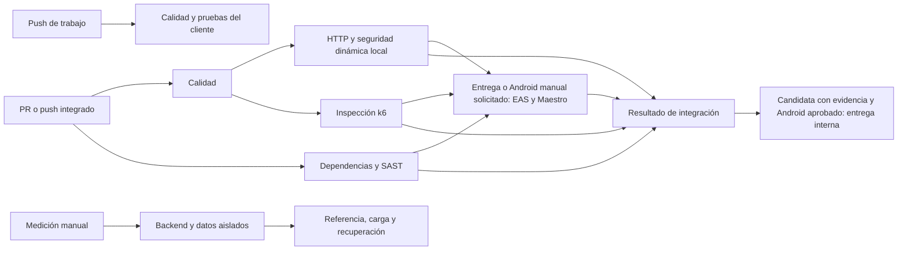

# Sport Center Mobile

Aplicación móvil de Sport Center para consultar productos deportivos y acceder a los servicios de la tienda.

Desarrollada con Expo SDK 57, React Native, TypeScript y Expo Router.
Repositorio: [Markadw/SportCenter-mobile](https://github.com/Markadw/SportCenter-mobile).

## Estado del proyecto

El proyecto está en desarrollo. La base disponible incluye carga inicial con la marca Sport Center, navegación inferior, inicio, búsqueda y catálogo con filtros y orden, y detalle de producto por variante con consumo del backend.

El cliente incluye registro, verificación, reenvío, inicio y cierre de sesión, restauración y renovación con almacenamiento seguro nativo. Incluye edición de perfil, recuperación de contraseña, consulta de pedidos propios y sus envíos, y reseñas con elegibilidad, reporte y ocultación local de autores. Las pruebas del cliente usan transporte simulado; los contratos HTTP públicos y la aceptación Android tienen evidencias independientes. También incluye carrito por variante, direcciones y resumen de checkout con apertura de Mercado Pago y consulta del estado del pedido. La evidencia vigente distingue pedidos/reseñas en Android aislado, formularios con correo real y compra/pago todavía pendientes; véase [Verificación](#verificación). El alcance y los responsables se consultan en el [tablero personal](https://github.com/users/Markadw/projects/2).

## Interfaces móviles

El primer bloque de interfaces se integró mediante el PR #41: Inicio, Catálogo y Cuenta son las pestañas principales. Las URL `/`, `/catalog` y `/account` se mantienen; registro, verificación, login y detalle se abren sobre esas pestañas. Cuenta muestra el acceso al usuario invitado y solo renderiza la vista autenticada si existe sesión.

Inicio muestra el buscador, deportes, productos más recientes y marcas, en ese orden, con opciones de la API. Se retiraron el banner y su consulta al backend. Marca y deporte abren su catálogo filtrado. La búsqueda funciona por nombre, descripción, marca, categoría y deporte, sin distinguir acentos. El catálogo admite orden por precio o nombre y el orden reciente que entrega el servidor, rango de precio y carga acumulada de 20 productos. Volver desde el detalle conserva la búsqueda; una selección nueva desde Inicio comienza otra consulta.

El detalle selecciona una combinación real de atributos; precio, fotos y existencias pertenecen a esa misma variante. Las tarjetas muestran su rango de precios. Compartir abre la herramienta del dispositivo con la URL real del sitio web. Se retiraron favoritos y promesas fijas de envío o devolución que no provenían de la API. El detalle permite elegir cantidad y agregar la variante al carrito. Inicio, Catálogo y Cuenta ofrecen acceso al carrito; las reseñas públicas se consultan también desde el producto.

La arquitectura sigue MVVM por funcionalidad: los servicios convierten la respuesta del backend; los modelos de vista de Inicio, Catálogo y Detalle manejan selección, consultas y filtros; las pantallas presentan sus estados. Los proveedores conservan los datos compartidos. El detalle sigue enviando el ID real a la API; la codificación del enlace público se usa únicamente al compartir.

El splash nativo usa el logotipo existente. En JavaScript, la carga inicial espera la primera consulta del catálogo y la restauración de sesión, sin demora artificial. Si falla, permite llegar al error con reintento; filtros e imágenes no bloquean la entrada. Una actualización posterior no vuelve a cubrir la app. La apariencia final del splash nativo requiere comprobar una compilación instalada, pues Expo Go no reproduce todos sus detalles.

[Prototipo editable en Figma](https://www.figma.com/design/Ae3JMeVAfcs6ulXI7dpx5k?node-id=5-50). Documenta el primer bloque y sus estados; no sustituye las comprobaciones en el dispositivo. El usuario confirmó el recorrido básico en Android; el alcance y los casos adicionales pendientes están en la [guía de comprobación móvil](tests/manual/interfaces-moviles.md).

Recuperación, perfil, pedidos y reseñas están conectados a sus servicios reales. Las pruebas del cliente usan respuestas controladas; la evidencia HTTP y nativa se documenta por separado en [Verificación](#verificación). Google, recomendaciones y Alexa quedan fuera del alcance. La operación de soporte y los flujos pendientes mantienen sus límites antes de una entrega pública.

## Registro de clientes (HU-01)

El icono de usuario abre Iniciar sesión cuando no hay sesión activa; desde allí, «Crear cuenta» abre el registro. Se solicitan nombre, ambos apellidos, correo, teléfono de 10 dígitos y contraseña con confirmación. Cada contraseña permite mostrar u ocultar su contenido mediante un botón. La contraseña requiere al menos 12 caracteres, mayúscula, minúscula, número y un símbolo admitido por el backend; la ayuda del formulario muestra la lista.

El servicio usa los endpoints públicos POST /users/create-user, /users/verify-email y /users/resend-code. Solo envía los seis campos de registro aceptados; la confirmación de contraseña es local. El contrato se revisó en AlexisYazir/back-sport, commit 31ee304d902ec5ec5a9c0fc702eca5e1a531bc16.

Después del registro se introduce el código recibido por correo. El backend establece vigencia de 24 horas y 3 intentos; reenviar genera un código nuevo. La verificación no inicia sesión. «Ya tengo un código» permite retomar el proceso después de salir de la app o perder la conexión.

Las peticiones tienen un límite de espera de 45 segundos y no se repiten automáticamente. Un timeout puede ocurrir después de que el servidor haya procesado el registro: la pantalla indica revisar el correo antes de reintentar. Se bloquean envíos simultáneos y se cancela la espera al salir de la pantalla. La aplicación no guarda contraseñas ni códigos en almacenamiento y descarta el hash y el código presentes en la respuesta actual del backend.

Jest comprueba validaciones, contrato de envío, errores, registro/verificación/reenvío y concurrencia con transporte simulado; estas pruebas automatizadas no crean cuentas en Render. El usuario confirmó en su Android, mediante Expo Go y la API real, el registro, la recepción del primer correo, el rechazo del código incorrecto, la recepción del reenvío y la verificación de la cuenta. El alcance y las limitaciones de esa comprobación están en [el registro manual](tests/manual/registro-cliente.md). El recorrido manual corresponde a HU-01 antes de incorporar la nueva base. El PR #36 conserva las comprobaciones de registro y su actualización. Tras verificar el correo se puede abrir Iniciar sesión; el registro también permite volver a login mediante «Ya tengo una cuenta».

## Cuenta, recuperación, pedidos y reseñas

El perfil usa GET /users/profile y PATCH /users/update-profile. Sólo se conservan nombre, apellidos, correo y teléfono; los datos internos de la respuesta se descartan. El ViewModel depende de ProfileRepository, su Factory recibe el transporte HTTP y Axios mantiene una única instancia de la app. Los contextos notifican cambios a sus suscriptores. Así se mantienen MVVM, Repository, Factory, Singleton y Observer en responsabilidades concretas, sin trasladar llamadas de red a las pantallas.

La recuperación solicita correo en POST /users/verify-user-email y envía el código junto con la nueva contraseña directamente a POST /users/reset-psw. No consume el código en un paso previo. Incluye validación, reenvío con espera, cancelación y protección frente a respuestas tardías.

Los pedidos usan exclusivamente la lista del cliente y su seguimiento. El detalle comprueba primero que el pedido esté en esa lista; no consulta endpoints administrativos. El backend omite los pendientes de pago de la lista: su ausencia no acredita un cobro ni una compra terminada.

Las reseñas son públicas; publicar requiere sesión, compra entregada confirmada por el servidor y aceptación explícita de reglas. El reporte usa el canal de contacto existente con folio de recepción. Ocultar autores es reversible y local: SecureStore en Android/iOS, separado por cuenta o invitado; en web sólo memoria. Decodificar el ID de una sesión para esa separación no autentica peticiones ni concede permisos.

El registro exige aceptar sin premarcar el tratamiento necesario de la cuenta. Conserva sólo versión del aviso, momento y enlaces en el dispositivo; no almacena contraseñas, códigos ni una preferencia comercial. La aceptación no se incorpora al contrato del backend.

Privacidad y solicitud de eliminación están disponibles sin sesión. El formulario registra una solicitud manual y un folio; no afirma que borre una cuenta. Los avisos web tienen datos de contacto inconsistentes y requieren corrección por el responsable. Los borradores de docs/public/ no están publicados. Véase [la revisión de privacidad](docs/privacy-review.md) para los pendientes que impiden declarar lista la publicación.

## Carrito, dirección y checkout

El carrito usa los servicios de cliente para consultar, agregar una variante, ajustar su cantidad o eliminarla. Precio, existencias y subtotal proceden del servidor. Una reducción de stock permite ajustar la cantidad disponible; los productos inactivos o sin existencias suficientes impiden continuar. La app no repite automáticamente las adiciones.

Checkout consulta direcciones propias, métodos de envío, cupones y totales. Permite seleccionar una dirección o capturar otra; la nueva dirección se registra únicamente al confirmar el pedido mediante la transacción que ofrece el backend. No se simulan endpoints independientes para editar o borrar direcciones que el servicio no proporciona. HU-06 no requiere ese CRUD separado.

La confirmación envía variante/cantidades desde el carrito del servidor, dirección, envío y cupón; no recibe datos de tarjeta desde la interfaz. Abre únicamente un enlace HTTPS del proveedor admitido. Volver del navegador no acredita un pago: se consultan seguimiento y pedidos propios, y se exige una fecha de pago válida para mostrar confirmación. Incidencias de stock y reembolsos tienen su propio estado.

La sesión delimita el formulario y la confirmación. Renovar un token de la misma sesión conserva la operación en curso; cambiar de cuenta descarta sus resultados. Una caída temporal mantiene el estado preparado o incierto sin habilitar acceso privado. Respuestas perdidas y rechazos HTTP no clasificados impiden crear otra orden desde el mismo borrador; no se garantiza idempotencia en el servidor ni persistencia de ese borrador al terminar el proceso de la app.

El login conserva un destino interno validado para volver al carrito, compra, producto o reseñas. URLs externas y parámetros ambiguos regresan a Cuenta. La confirmación tiene 45 segundos de espera; un timeout sigue siendo un resultado incierto.

Véanse [la comprobación de compra](tests/manual/compra-cliente.md) y [la de cuenta](tests/manual/cuenta-cliente.md). Las pruebas visuales controladas no crean pedidos o cobros reales ni sustituyen su aceptación en Android.

## Entorno y arranque

Usar Node 22.20.0 o superior compatible con SDK 57 y npm. Desde la carpeta del proyecto:

```powershell
npm ci
npm run start:go
```

Escanear con Expo Go compatible con SDK 57 el QR que muestre esa terminal. Mantener el teléfono y la PC en la misma red y la terminal abierta. La dirección de Metro corresponde a la conexión de esa ejecución. Para limpiar su caché: `npm run start:go -- --clear`. Si se utiliza un development build instalado, ejecutar `npm run start:dev-client` y usar una conexión Metro permitida por ese perfil; la configuración nativa se comprueba con su propio binario.

La API predeterminada es https://back-sport-ghxk.onrender.com. Para cambiarla, copiar `.env.example` a `.env.local` y definir `EXPO_PUBLIC_API_URL`. Recargar completamente la aplicación después del cambio. Los valores EXPO_PUBLIC_ son públicos en el bundle; no guardar secretos allí.

Instalar paquetes con `npx expo install <paquete>` para resolver versiones compatibles con el SDK. Las carpetas android/ e ios/ se generan con Expo; la configuración nativa se mantiene mediante app.json y plugins.

## Inicio de sesión

El icono de usuario abre login o Mi cuenta según la sesión. El formulario usa POST /users/login-user, valida correo y contraseña, admite mostrar/ocultar y presenta los errores sin mostrar detalles internos. Mi cuenta permite abrir perfil, pedidos y privacidad. HU-09 consulta y actualiza los cinco datos editables del perfil.

El token de acceso permanece en memoria. En Android e iOS, SecureStore conserva únicamente el token de renovación y el identificador de sesión. Al abrir la app se valida la sesión mediante renovación; al cerrar sesión se retira el acceso local y se elimina la credencial persistida. La renovación se coordina entre solicitudes y protege los cambios de cuenta. Sólo GET/HEAD pueden repetirse una vez tras un 401; las operaciones de compra y otras mutaciones requieren reenvío manual. Los fallos de almacenamiento o conexión se muestran sin afirmar una persistencia o un cierre remoto que no estén confirmados.

En web los tokens se conservan sólo en memoria. La configuración nativa Android incluye HTTPS, pines SHA-256 de la API con respaldo, permisos acotados y R8/reducción de recursos en Release. Estas protecciones requieren una compilación propia; Expo Go permite comprobar JavaScript e interfaces, pero no acredita la configuración nativa de esta aplicación.

Para Expo Go compatible con SDK 57, usar `npm run start:go`. Para un development build instalado, usar `npm run start:dev-client`; el perfil de desarrollo admite Metro mediante USB/localhost o emulador. `preview` genera APK y `production` AAB. La validación final del binario y sus recorridos debe registrarse por separado de las pruebas Jest.

Las pruebas históricas de inicio están en tests/manual/inicio-sesion.md. Jest usa transportes controlados; la aceptación con cuenta y servidor reales en emulador Android se documenta por separado en [la guía de cuenta](tests/manual/android-account.md). Ninguna de ellas sustituye una comprobación física completa.

La prueba `tests/integration/AuthenticationFlow.test.tsx` recorre registro, reenvío, verificación, login y cierre con transporte simulado. No envía correos ni comprueba un teléfono real.

## Verificación

```powershell
npm run validate
npx expo-doctor
```

- `npm run lint`: revisión ESLint del proyecto.
- `npm run typecheck`: comprobación TypeScript sin generar JavaScript.
- `npm run lint:report` y `npm run typecheck:report`: ejecutan los analizadores instalados con la configuración del proyecto y guardan sus informes en `test-results/static-analysis/`.
- `npm run validate`: ejecuta lint, TypeScript, pruebas del cliente con cobertura y validación de configuración; se detiene ante un fallo.

La validación del cliente usa transporte HTTP simulado. No consulta la API desplegada ni ejecuta aceptación Android o carga. El empaquetado de JavaScript tampoco equivale a generar un APK firmado.

### Evidencia vigente RC6

La [regresión final QA-001](tests/manual/regresion-final.md) identifica el corte integrado, la candidata y las evidencias que conservan su alcance. Su [registro de identidad](evidence/regresion-final-corte.json) distingue el recorrido adicional del cliente de la aceptación Android y mantiene pendiente el checkout autorizado con Mercado Pago.

La fuente de aplicación de RC6 es `8831dfad7fd1b0c696d11f50c79442c5499b7cd2`. Los cambios posteriores de automatización no reconstruyen sus binarios ni permiten trasladarles los resultados de otra fuente. El [CI integrado](https://github.com/Markadw/SportCenter-mobile/actions/runs/41952408742) aprobó para develop `ac5352e`; sus resultados se mantienen separados de la aceptación nativa.

- Preview `601a02d2-0dc8-48dd-939b-98c7d6b80b69`: [productor RC6, intento 2](https://github.com/Markadw/SportCenter-mobile/actions/runs/41860689069/attempts/2) aprobado con catálogo/detalle API34 y rechazo TLS/recuperación API30. El intento previo que agotó la espera se conserva; se reutilizó el mismo build.
- [Formularios de correo Android](tests/manual/android-email-forms.md): [registro/reenvío](https://github.com/Markadw/SportCenter-mobile/actions/runs/41889146245) acreditó EF01–02; [verificación](https://github.com/Markadw/SportCenter-mobile/actions/runs/41891484613), EF03–04; [reset v6](https://github.com/Markadw/SportCenter-mobile/actions/runs/41952937825), EF06–09, incluido acceso/cierre con la contraseña nueva. La [solicitud independiente](https://github.com/Markadw/SportCenter-mobile/actions/runs/41955843077) acreditó EF05 con operación sin incertidumbre y limpieza confirmada. Completan nueve controles distintos, repartidos 2+2+4+1. Los runs de verificación y reset conservan su último EF05 fallido y su incertidumbre original; tres recepciones de correo se confirmaron por separado y no sustituyen la aprobación de interfaz. No se repitió el reset ya completado.
- [Pedidos y reseñas en Android aislado](tests/manual/android-commerce.md): [validación v6](https://github.com/Markadw/SportCenter-mobile/actions/runs/41898074821) aprobó pedidos propios con contenido y seguimiento, separación de cuentas, elegibilidad/publicación/persistencia de reseñas y ocultar/restaurar autores. Usa nativo Debug histórico `5dcacd4`, JavaScript `8831dfa`, backend congelado `31ee304` y datos sintéticos. No acredita ese recorrido en Preview/AAB, compra productiva, pago o dispositivo físico.
- El [recibo HTTP de reporte aislado](tests/environment/commerce-README.md#recibo-de-reporte-de-reseña), integrado en [PR68](https://github.com/Markadw/SportCenter-mobile/pull/68), aprobó rechazo de solicitudes inválidas, folio positivo y persistencia exacta sin lectura ni respuesta. No acredita Android, envío de correo, atención humana, retirada de contenido ni eliminación de cuenta.
- [Release AAB RC6](tests/manual/android-release.md), build `43bcc31d-8297-48e4-b91e-7f37c63d349c`: [validación real](https://github.com/Markadw/SportCenter-mobile/actions/runs/41890488214) aprobó firma/manifiesto y cuatro casos públicos por API34/API36, ocho ejecuciones. API36 confirmó páginas de 16 KB antes/después y compatibilidad de 4 KB desactivada. El derivado usa firma temporal y emuladores x86_64; no acredita ARM64 físico, cuenta privada del AAB, Play App Signing ni publicación.

Siguen pendientes persistencia de dirección al confirmar compra y el flujo autorizado de pedido/pago con Mercado Pago, la suite física completa, la atención operativa y los requisitos legales/Play Console. Los borradores y un folio no acreditan su cumplimiento. Las pruebas RC5/F2 siguientes conservan exclusivamente su fuente histórica; no se suman sus conteos ni se presentan como aceptación de RC6.

### Evidencia histórica F2

<details>
<summary>Ver el corte F2 y sus resultados originales</summary>

Las referencias a `not_run` en este corte describen el estado de F2 antes de las aceptaciones RC5/RC6 anteriores. Los runs conservan sus identidades; los archivos de configuración relativos pueden haber evolucionado con el repositorio.

La fuente histórica F2 es `e15671b17615621b29f4bc4bb9c0ccfdf167e657`. Su [CI previa en develop](https://github.com/Markadw/SportCenter-mobile/actions/runs/41707259944) aprobó calidad, seguridad, contratos HTTP, seis comprobaciones dinámicas de lectura en la copia aislada e inspección de guiones k6. Android y TLS se omitieron por la matriz de esa rama. El corte local de esa fuente aprobó 1702 pruebas del cliente y su infraestructura; la preparación posterior de automatización aprobó 1763 pruebas en 67 suites, sin omisiones. Son comprobaciones locales de alcances distintos, no una aceptación nativa del binario final.

El AAB de F2 `2e902741-6bfd-4171-a336-2a784ae41f58` terminó en EAS y se descargó: **68 959 549 bytes**, SHA256 `7ffe6560cf3eddb41f5a595c2073cc1e5a3e07e27ffc695e18d3eb6a0635a253`. El [recibo de procedencia](config/android-release-validation.json) contiene esos datos reales; se verificaron su esquema, los metadatos EAS y la CI previa. La [validación nativa del AAB](https://github.com/Markadw/SportCenter-mobile/actions/runs/41727765066) aprobó inspección y ocho ejecuciones: catálogo, detalle y dos URI en cada emulador API34/API36. API36 confirmó páginas de 16 KB y compatibilidad de 4 KB desactivada. El APK derivado usa una firma temporal; estas pruebas no acreditan la firma de Google Play ni un teléfono físico.

El APK preview de la misma fuente es `b409ac48-41b0-4292-8e9c-df8153006f71`, también FINISHED. El primer intento de la [candidata rc4](https://github.com/Markadw/SportCenter-mobile/actions/runs/41708999367) agotó la espera de EAS mientras ese build seguía en cola. El segundo intento reutilizó ese mismo build y aprobó inspección, catálogo/detalle API34 y rechazo TLS controlado con recuperación API30. No creó otro APK. Los recorridos privados finales continúan `not_run`: su automatización requiere una cuenta de pruebas verificada y reservada. La comprobación física sigue aplazada por el usuario.

</details>

La revisión de dependencias conserva **tres alertas altas y cero críticas** en npm audit. El backport del decoder mantiene su versión CommonJS y aplica las correcciones revisadas; los avisos por rango de versión permanecen visibles. Véanse [el parche y sus límites](docs/decoder-seguro.md) y [la auditoría de la candidata](docs/seguridad-candidata.md).

### Pruebas

| Comando | Alcance |
| --- | --- |
| `npm test` | Pruebas Jest del cliente |
| `npm run test:unit` | Lógica y componentes en __tests__/ |
| `npm run test:integration` | Integración de vistas, contextos y servicios con transporte simulado |
| `npm run test:ci` | Jest con cobertura y reporte JSON en test-results/ |
| `npm run test:config` | Coherencia de workflows, flujos Maestro, perfil EAS y plan de pruebas |
| `npm run test:api` | Contratos HTTP reales de lectura; requiere API_BASE_URL explícita |
| `node scripts/dast-local.js` | Seis casos HTTP de seguridad en la copia local preparada; exige aislamiento y procedencia, sin escrituras ni escaneo de Render |
| `npm run env:start` / `npm run env:stop` | Preparar o detener backend y datos sintéticos locales |
| `npm run test:performance -- all` | Referencia, carga y esfuerzo en la copia local |

Para ejecutar las consultas HTTP públicas desde PowerShell:

```powershell
$env:API_BASE_URL = 'https://back-sport-ghxk.onrender.com'
npm run test:api
```

La suite HTTP consulta catálogo, detalle y rechazo del perfil sin sesión; no crea cuentas ni modifica datos. Los resultados de cada ejecución se distinguen de la preparación de sus scripts.

Los PR hacia `develop`, tanto en borrador como listos, exigen lint, TypeScript, pruebas del cliente, seguridad, contratos HTTP con las comprobaciones dinámicas locales e inspección k6. No generan APK ni ejecutan Android automáticamente. Para comprobar Android se utilizan etiquetas explícitas e inmutables: `candidate/android-*` genera una candidata, `validation/android-*` revalida el APK histórico identificado y `validation/release-*` comprueba el AAB final identificado. GitHub sólo ofrece `workflow_dispatch` cuando el workflow existe en la rama predeterminada; como `main` aún no lo contiene, la selección manual de `develop` con `run_android` quedará disponible cuando se cumpla esa condición. El push posterior a un merge tampoco repite Android. Un fallo de calidad, seguridad o HTTP bloquea la integración.

Los flujos Maestro de catálogo y detalle siguen disponibles sobre un APK candidato en un emulador Android API 34 de GitHub. La etiqueta de candidata exige la compilación EAS y Maestro; la etiqueta de validación reutiliza el build identificado y exige su procedencia y ejecución real. El modo histórico `validation/profiles-*` conserva los builds Debug y AAB de la fuente `5dcacd46a24ae54da5300cd394a91c590a9a5825`, según [su guía](tests/manual/android-profiles.md); esos resultados no acreditan F2. El modo nuevo [production-release-only](tests/manual/android-release.md), mediante `validation/release-*`, exige el recibo del AAB vigente, lo inspecciona y deriva un APK con firma temporal para AVDs separadas API34 y API36/16 KB. Comprueba los dos recorridos públicos y dos URI nativas por AVD: Unicode/`+` y entrada malformada con retorno al catálogo. Estas URI prueban el enrutamiento y la defensa de entrada; la malformada se rechaza antes del decoder y no acredita su algoritmo de recuperación en Hermes. El Debug previo mantiene exclusivamente su evidencia histórica. Omitir Android permite continuar el desarrollo, pero no acredita una prueba del APK. Las entregas a main conservan su política de aceptación Android.

Los guiones k6 de rendimiento y estrés requieren una API propia aislada y un commit de backend identificado. No ejecutarlos contra el Render compartido ni servicios de pago. Su inspección no equivale a medir capacidad o aprobar rendimiento.

### Matriz de automatización

Se mantienen tres pipelines principales: cliente (`ci.yml`), integración y aceptación (`api-android.yml`) y rendimiento (`performance.yml`). `security.yml` es reutilizable y `android-validation.yml` es auxiliar del segundo pipeline; sus modos históricos y Release final no añaden otro pipeline principal.

| Evento | Rama o destino | Comprobaciones |
| --- | --- | --- |
| Push de trabajo | feature/*, fix/*, chore/*, test/*, release/*, hotfix/* | Calidad si no hay PR para ese commit; con PR se evita repetirla |
| PR en borrador | develop o main | Calidad, seguridad, HTTP con seguridad dinámica local e inspección k6; sin compilar APK |
| PR listo | develop | Calidad, seguridad, HTTP con seguridad dinámica local e inspección k6; sin APK ni Android automáticos |
| PR listo | main | Calidad, seguridad, HTTP con seguridad dinámica local, inspección k6 y compilación/aceptación Android |
| Push integrado, incluido merge | develop | Calidad, seguridad, HTTP con seguridad dinámica local e inspección k6 |
| Push integrado, incluido merge | main | Calidad, seguridad, HTTP con seguridad dinámica local, inspección k6 y compilación/aceptación Android; conserva evidencia |
| Manual, cuando workflow_dispatch esté disponible | develop, release/* o hotfix/* | Integración; Android opcional sólo en develop y obligatorio en candidatas |
| Tag de candidata | candidate/android-* | Calidad, HTTP, seguridad, APK, aceptación API34 y rechazo controlado API30; conserva evidencia |
| Tag de validación | validation/android-* | Auxiliar del segundo pipeline: calidad, seguridad, procedencia e inspección del mismo APK, API34, API30 y ejecución de 16 KB simulados en API36 x86_64; sin nueva compilación EAS |
| Tag de perfiles | validation/profiles-* | Auxiliar del segundo pipeline: procedencia congelada de Debug/AAB, políticas y firmas, Debug con Metro en API34, APK derivado del AAB sin Metro y simulación 16 KB API36; no compila ni publica |
| Tag de Release AAB | validation/release-* | Auxiliar del segundo pipeline: calidad y seguridad previas, recibo y SHA del AAB final, inspección y APK derivado en API34 y API36/16 KB con URI públicas; no reconstruye Debug ni publica |
| Medición manual | develop o ramas de trabajo | Referencia, carga y esfuerzo con backend y datos aislados en el runner |

El merge se atiende mediante push a su destino. No se añade un segundo disparador por cierre del PR. El resultado Resultado de integración falla si una etapa obligatoria falla, se cancela o se omite; en `develop` está marcada como requerida para integrar cambios. Los PR verifican la combinación con la base y los pushes verifican el commit de la rama. En una rama con PR abierto pueden aparecer dos eventos de GitHub: el push sólo consulta si el PR se hace cargo y omite el trabajo duplicado. No hay ejecuciones programadas ni reintentos automáticos de Android.

Las etiquetas `candidate/android-*` publican `Resultado de candidata Android`, para que una compilación explícita pendiente o fallida del mismo SHA no se confunda con el check obligatorio del PR. También usan ese nombre las ejecuciones manuales que solicitan Android y las candidatas manuales de `main`, `release/*` o `hotfix/*`. Todos los PR a `develop`/`main` y los pushes normales conservan exactamente `Resultado de integración`; sus dependencias y bloqueos no cambian.

El resumen de calidad incluye versión, código de salida y diagnósticos de ESLint y TypeScript. TypeScript se ejecuta aunque ESLint falle para informar ambos resultados; las pruebas posteriores e integración continúan bloqueadas. Un informe ausente, de otra ejecución o de una etapa omitida se señala explícitamente. Los JSON se incluyen en el mismo `client-evidence`, sin añadir artefactos.

Las ejecuciones ordinarias publican resultados en el resumen y los logs, sin subir informes de pruebas. Se conservan paquetes compactos ante fallos, en PR hacia main, en main, en candidatas manuales y en PR marcados con la etiqueta `evidencia`. La etiqueta `evidencia` conserva informes; en los PR a develop no activa APK ni Android. La entrega interna requiere además una ejecución con Android aprobado. Todos tienen retención de 14 días. Una simple inspección k6 no genera artefactos; una medición real conserva un único paquete con sus JSON y resumen. Los APK permanecen en EAS y no se duplican en los artefactos de GitHub.

Los reportes de GitHub Actions son evidencias de esas ejecuciones; los archivos históricos de evidence/ conservan su fecha y commit originales.

La entrega interna desde una rama exige evidencia y aceptación Android aprobada antes de registrar `qa-interna` en GitHub, después de `Resultado de integración`. Reutiliza el enlace EAS y el SHA256 del mismo APK comprobado; no vuelve a compilarlo. Las etiquetas de candidata y validación no registran automáticamente esa entrega. Si una comprobación obligatoria falla o se omite, se bloquea. El registro permite instalación interna; no publica Google Play ni modifica ramas.




### Evidencia histórica de cuenta: F2 y RC5

Los resultados siguientes corresponden a las fuentes F2/RC5 indicadas en cada ejecución. No se atribuyen al APK o AAB RC6; su estado vigente está en [Evidencia vigente RC6](#evidencia-vigente-rc6).

El auxiliar `validation/account-*` reutiliza el Preview F2 identificado arriba. Comprueba inicio, perfil de lectura, carrito, resumen sin confirmar compra, restauración al cerrar/abrir, cierre y protección como invitado. Requiere una cuenta de cliente verificada y reservada, con producto disponible en el carrito y los secretos `ANDROID_TEST_EMAIL` y `ANDROID_TEST_PASSWORD`. No modifica perfil, direcciones o carrito ni crea pedidos o pagos. Un carrito vacío bloquea el caso sin agregar productos.

La [guía de cuenta Android](tests/manual/android-account.md) distingue los siete controles de sesión, cuatro de lectura y cinco nuevos de edición reversible, con su procedencia y estado de ejecución. Maestro se ejecuta con un UID efímero y tráfico IP restringido a loopback; el emulador conserva su conexión HTTPS. Los dos informes públicos sólo contienen IDs, huellas, estados y códigos permitidos. Capturas, XML, registros y credenciales quedan fuera de los artifacts. La [aceptación real del APK, intento 3](https://github.com/Markadw/SportCenter-mobile/actions/runs/41749782319/attempts/3) aprobó los siete controles AC01–AC07, con limpieza confirmada. Los intentos anteriores permanecen como histórico: credenciales rechazadas en el primero y carrito vacío en el segundo. No acredita edición de perfil/dirección, pedidos, pagos, revocación independiente en servidor ni el recorrido completo en teléfono físico.

La [regresión adicional Android v7](https://github.com/Markadw/SportCenter-mobile/actions/runs/41774275494) aprobó cuatro comprobaciones: pedidos mostró el estado vacío real, perfil y checkout protegieron sus entradas directas tras logout, y privacidad/documentos/sesión local fueron accesibles como invitado. La misma ejecución repitió y aprobó AC01–AC07; son siete controles base y cuatro adicionales, sin sumar ejecuciones históricas. Publica sólo estados y la clasificación empty/list. No acredita detalle de un pedido existente, seguimiento, documentos externos actualizados ni pagos, y no envió solicitudes o cambios de negocio.

La [candidata RC5](https://github.com/Markadw/SportCenter-mobile/actions/runs/41810909053), fuente `8e8a6da`, incorpora la corrección de recarga del carrito del PR #60 y aprobó calidad, seguridad, contratos HTTP, inspección del APK, catálogo/detalle en API34 y rechazo TLS con recuperación en API30. La [aceptación de cuenta RC5](https://github.com/Markadw/SportCenter-mobile/actions/runs/41821737397) aprobó dieciséis controles: siete de sesión, cuatro de lectura y cinco de edición reversible de perfil/carrito. Confirmó persistencia tras arranque frío, restauración de la línea base y limpieza completa. Registro, reenvío, verificación y recuperación también completaron la secuencia HTTPS con buzón real de una cuenta aislada, sin usar códigos de la respuesta de registro. Ese resultado HTTP no se presenta como recorrido nativo de los formularios.

El [AAB de producción RC5](https://github.com/Markadw/SportCenter-mobile/actions/runs/41825217994), build `c55fd545-cff4-4758-a5be-5bc583b85589` de la misma fuente `8e8a6da`, aprobó firma, manifiesto y ocho ejecuciones públicas en API34/API36: catálogo, detalle y dos enlaces por entorno. API36 confirmó páginas de 16 KB antes/después con compatibilidad desactivada y sin fallos fatales. La [guía Release](tests/manual/android-release.md) conserva hash, procedencia y límites. Esa aceptación no acredita teléfono físico, cuenta privada dentro del APK derivado, pago ni publicación en Play.

### Evidencia Android histórica

Los resultados siguientes conservan sus commits y artefactos originales. La aceptación pública de F2 se registra por separado en los runs rc4 y Release AAB enlazados arriba; los once controles históricos de sesión/lectura se distinguen de la edición RC5 aprobada arriba. La comprobación física completa mantiene su evidencia pendiente.

La [candidata del PR #35](https://github.com/Markadw/SportCenter-mobile/actions/runs/40506781998), sobre `ee736e8`, aprobó 140 pruebas, cuatro contratos por entorno y dos recorridos públicos Android. El APK preview terminó en EAS con el identificador `812e78fa-1511-40c7-89d9-de796a8fba01`. Esta aceptación comprueba catálogo y detalle.

La [validación de la base integrada](https://github.com/Markadw/SportCenter-mobile/actions/runs/40537859651), commit `d5c842a`, aprobó calidad, 140 pruebas, contratos HTTP e inspección k6 después del merge a develop, sin repetir APK ni Android. La comprobación manual de registro se conserva por separado en HU-01.

La [candidata histórica ac6bf53](https://github.com/Markadw/SportCenter-mobile/actions/runs/40453688133) conserva su evidencia de 122 pruebas, cuatro contratos por entorno, dos recorridos Android y entrega interna.

La [validación de la política integrada en develop](https://github.com/Markadw/SportCenter-mobile/actions/runs/40563479112), commit `935725a`, aprobó lint, TypeScript, 141 pruebas, cuatro contratos HTTP por entorno e inspección k6. Resultado de integración aprobó sin APK ni Android. Esa ejecución comprueba la base de automatización; las pruebas de HU-01 y su aceptación manual se mantienen por separado.

El proyecto EAS es `anth.oi/sport-center-mobile` y el paquete Android es `com.markadw.sportcenter`. GitHub tiene configurado `EXPO_TOKEN`; las credenciales de firma se administran en EAS.

Como evidencia histórica, la [revisión de referencia edca463](https://github.com/Markadw/SportCenter-mobile/actions/runs/40435769513) aprobó calidad, 96 pruebas del cliente e infraestructura, cuatro contratos HTTP y dos recorridos Android. Su APK terminó en EAS y fue instalada en el emulador API 34. Estos resultados acreditan el incremento de catálogo y detalle básicos.

- `API_TEST_URL` elige el backend de los contratos y del APK; `API_TEST_PRODUCT_ID` fija el producto HTTP y `ANDROID_TEST_PRODUCT_NAME` el producto de Maestro.
- La preparación comprueba que la API responda y que Android tenga una red validada. Los flujos arrancan con estado limpio.
- EAS debe terminar el APK del commit comprobado. CI verifica procedencia y SHA256 antes de instalarlo.
- `preview` genera APK para distribución interna y `production` prepara AAB. La publicación en Google Play sigue pendiente.
- Las capturas y el informe Maestro se conservan ante fallos o cuando se solicita evidencia de una candidata; el APK permanece en EAS.

### Copia local del backend para pruebas

Requiere Docker Desktop en modo de contenedores Linux, Git y Node. El backend real se fija al commit indicado en `tests/environment/backend-source.json`; la copia descargada queda en `.qa/`, fuera de Git.

```powershell
node scripts/test-environment.js start
$env:API_BASE_URL = 'http://127.0.0.1:3011'
$env:API_PRODUCT_ID = '66'
npm run test:api
node scripts/test-environment.js stop
```

El entorno crea PostgreSQL temporal con 100 productos y 200 variantes sintéticos; el producto conocido es el 66. Al detenerlo se descarta esta base de pruebas y el siguiente arranque la vuelve a preparar. No utiliza datos ni credenciales del servidor compartido.

API, PostgreSQL y k6 comparten una red interna. Una entrada de sólo lectura permite consultar la API desde Windows en `127.0.0.1:3011`. Las lecturas de catálogo y detalle usan los controladores y consultas del backend real. Correo, pagos y funciones que dependan de procedimientos SQL externos no forman parte del alcance comprobado.

El esquema local se crea desde las entidades del backend. Esta preparación pertenece únicamente al entorno aislado; no sustituye las migraciones del servidor desplegado.

La [comprobación de direcciones nuevas](tests/environment/checkout.md) añade el esquema auxiliar del checkout y verifica con el backend real que un fallo revierte dirección y pedido. El guardado positivo tras crear una preferencia de Mercado Pago continúa pendiente de su entorno de prueba autorizado; HU-06 permanece en Pruebas.

### Rendimiento y recuperación comprobados

```powershell
npm run test:performance -- all
npm run env:stop
```

El comando prepara la copia local, reinicia la API antes de cada escenario para separar las ventanas del limitador y guarda los resultados en `test-results/performance/<ejecución>/`. El perfil acordado está en `tests/performance/profile.json`: referencia de un usuario; carga de dos usuarios, P95 menor de 500 ms y cero errores; esfuerzo de hasta ocho usuarios y recuperación en un máximo de 65 segundos. Cada usuario consulta catálogo y detalle, con tres segundos entre iteraciones.

La [medición local del 26 de octubre](evidence/performance-local-2026-10-26.json) obtuvo referencia P95 de **10,08 ms** (20 solicitudes), carga P95 de **8,25 ms** (80 solicitudes, cero errores) y recuperación en **35,91 segundos**. La verificación final obtuvo 12 pares de consultas correctos y cero errores. El esfuerzo activó el límite real de solicitudes: hubo 86 respuestas 429 durante la fase de sobrecarga; también se observaron rechazos mientras se recuperaba la ventana de admisión. El P95 de esfuerzo incluye rechazos y no se compara con el objetivo de carga normal.

Estos resultados corresponden al backend fijado, con 100 productos y 200 variantes sintéticos y los recursos anotados en la evidencia. No miden fluidez Android ni la capacidad del servidor compartido. Los JSON completos de cada medición permanecen fuera de Git; CI los conserva en un solo artefacto por medición. Un fallo de k6 devuelve error y conserva su diagnóstico.

### Documentación de arquitectura

La [arquitectura y los patrones aplicados](docs/arquitectura.md) describen la composición y sus límites. La aplicación usa rutas en `src/app/`, vistas y estado por función en `src/features/`, y acceso HTTP en `src/api/`. Las pruebas del cliente simulan el transporte para comprobar estados y errores; los contratos HTTP comprueban el backend real; Maestro comprueba los dos recorridos básicos sobre el APK.

[DeepWiki del repositorio](https://deepwiki.com/Markadw/SportCenter-mobile) mostraba el índice del commit `f24ccc` de `main` en la última revisión registrada, del 26 de octubre. Ese índice aún no documenta este PR. El código, los workflows y este README son la referencia actual; la actualización de DeepWiki queda pendiente de una indexación de la versión integrada. No se modifica `main` para adelantarla.


## Alcance de las historias

Los criterios de HU-03 (#9) y HU-04 (#10) del tablero cubren catálogo y detalle públicos con datos reales y manejo de estados. Registro, sesión segura, perfil, carrito, direcciones/resumen de compra y pedidos están implementados, al igual que las ampliaciones autorizadas de recuperación y reseñas. Las pruebas del cliente comprueban sus contratos, lógica y estados mediante transportes controlados. La aceptación de cuenta F2 aprobó inicio, perfil de lectura, carrito, resumen, restauración, cierre y protección de invitado en emulador API34. La edición de perfil y las operaciones del carrito aprobaron la aceptación RC5 con restauración. Pedidos con contenido/seguimiento y reseñas ya cuentan con la comprobación Debug aislada descrita en [la guía de comercio Android](tests/manual/android-commerce.md). No equivale a compra/pago productivo ni a aceptación física completa, que mantienen sus comprobaciones pendientes.

La matriz `tests/plan.json` conserva las nueve historias iniciales y añade HU-10 (#47, recuperación) y HU-11 (#48, reseñas), autorizadas sin alterar los 52 SP de la línea base. Los estados del tablero requieren conciliación con las entregas: una issue cerrada o una fecha vencida no sustituye la evidencia de implementación.

## Ramas y revisión

- `main`: versiones terminadas y comprobadas.
- `develop`: integración de tareas aprobadas.
- `feature/<tarea>`, `fix/<tarea>` y `chore/<tarea>`: trabajo con alcance concreto desde develop; PR hacia develop.
- `release/<version>`: opcional para preparar una entrega desde develop; PR a main y reintegración de sus correcciones a develop.
- `hotfix/<problema>`: corrección urgente desde una versión publicada en main; integrar también en develop.

Las versiones de entrega utilizarán SemVer (`MAJOR.MINOR.PATCH`) y tags `vX.Y.Z` sobre versiones revisadas e integradas en `main`.

Cada tarea incluye el código, las pruebas y la configuración que necesita. Las ramas muestran el proyecto completo; los commits y la pestaña Files changed del PR delimitan el trabajo realizado. Si hay dependencias entre tareas, integrar primero la base y después continuar desde develop actualizado.

`develop` exige PR, conversaciones resueltas y el check `Resultado de integración` aprobado y actualizado con la base. La aprobación humana de otro colaborador es opcional, conforme al flujo acordado. La regla también se aplica a administradores e impide force-push y borrado. `main` exige PR, al menos una aprobación de otro colaborador, conversaciones resueltas y `Resultado de integración` aprobado con la base actualizada. La protección se aplica también a administradores y bloquea push forzado y borrado. Configurar esta protección no modifica el contenido de la rama.

## Carpetas

- `src/app/`: rutas y composición de navegación con Expo Router.
- `src/features/`: pantallas, componentes, estado y tipos por función.
- `src/api/`: cliente HTTP, endpoints y conversión de datos.
- `src/config/`: configuración pública del backend.
- `src/components/` y `src/constants/`: componentes y estilos compartidos.
- `assets/`: logo y recursos utilizados por la aplicación y su configuración.

No subir node_modules, cachés, .env locales, reportes generados, claves de firma ni carpetas nativas generadas.

Documentación: [Expo SDK 57](https://docs.expo.dev/versions/v57.0.0/), [variables de entorno](https://docs.expo.dev/guides/environment-variables/) y [ESLint](https://docs.expo.dev/guides/using-eslint/).

La [seguridad de la candidata](docs/seguridad-candidata.md) documenta Semgrep, CodeQL y los límites de inspección del APK. Los [reintentos EAS](docs/reintentos-eas.md) evitan crear sustitutos silenciosos. El [piloto nativo](tests/manual/android-pinning-pilot.md) usa el mismo APK en un emulador temporal, con controles de confianza, rechazo y recuperación. La existencia de estos guiones no acredita su ejecución; consultar el resultado de la candidata correspondiente.
