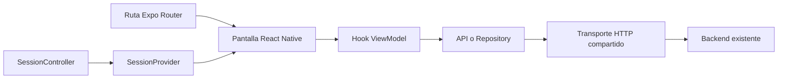

# Arquitectura del cliente móvil

Sport Center organiza el cliente con MVVM ligero por funcionalidad. Las rutas de Expo Router componen pantallas; las pantallas presentan datos y acciones; los hooks ViewModel coordinan formularios, validación, carga y errores. Las APIs y repositorios adaptan el contrato del servidor antes de presentar sus respuestas.

La separación permite probar estados con un transporte controlado. Hay dependencias de React en los hooks y módulos que importan directamente su API: no se presenta como una implementación completa de Clean Architecture ni como un dominio independiente de todos los frameworks.

## Patrones aplicados

| Patrón | Código y función |
| --- | --- |
| Singleton por módulo | [axiosClient](../src/api/axios.ts) comparte una instancia y su configuración. Las credenciales corresponden a cada petición, sin fijar una cuenta en headers globales. |
| Repository | [ProfileRepository](../src/features/profile/repositories/ProfileRepository.ts) define get y update y adapta únicamente los campos permitidos del perfil. |
| Factory | createProfileRepository recibe un ProfileTransport y construye un repositorio independiente. [profileApi](../src/api/profileApi.ts) realiza la composición con el transporte real. |
| Observer | [SessionController](../src/features/auth/context/SessionController.ts) notifica snapshots mediante subscribe. [SessionProvider](../src/features/auth/context/SessionContext.tsx) suscribe React mediante useSyncExternalStore. El controlador pertenece al proveedor; no se declara otro Singleton global. |

Las [pruebas del repositorio de perfil](../__tests__/profileRepository.test.ts) comprueban dos transportes aislados y la selección de campos. Las [pruebas de sesión](../__tests__/SessionController.test.ts) cubren restauración, renovación, concurrencia, cierre y respuestas antiguas. La existencia de patrones en perfil y sesión no implica que cada módulo tenga una clase Repository o un caso de uso independiente.

## Límites de cada módulo

- [Registro](../src/features/registration): formulario, consentimiento necesario, verificación y reenvío. El cliente descarta campos internos de la respuesta; no modifica lo que el backend transmite por la red.
- [Autenticación](../src/features/auth): sesión, inicio, cierre y protección de acciones privadas. La credencial de acceso vive en memoria; Android/iOS conservan sólo la renovación y el identificador de sesión en SecureStore. Web conserva la sesión en memoria.
- [Productos](../src/features/products) y [catálogo](../src/features/catalog): consulta pública, filtros, detalle, variantes y estados de carga o error.
- [Perfil](../src/features/profile), [pedidos](../src/features/orders) y [recuperación](../src/features/passwordRecovery): contratos del cliente, edición permitida y datos de la cuenta actual. La recuperación envía código y contraseña nueva directamente al contrato de restablecimiento, sin consumir antes el código en otra verificación.
- [Carrito](../src/features/cart) y [checkout](../src/features/checkout): precios y stock del servidor, dirección guardada o nueva, resumen y estado del pedido. Una confirmación de resultado incierto no genera otro POST automáticamente. El borrador es temporal y no añade idempotencia al backend.
- [Reseñas](../src/features/reviews) y [privacidad](../src/features/privacy): elegibilidad del servidor, reglas, reporte con folio y preferencias locales por cuenta. Un folio de contacto no acredita moderación ni eliminación de datos ejecutada.
- [Enlaces nativos](../src/features/navigation): valida rutas y parámetros; el retorno de login admite sólo destinos internos previstos.

Mercado Pago se abre en su navegador HTTPS permitido. Regresar a la aplicación no confirma un pago: se consulta el estado del servidor. Los datos de tarjeta no se introducen ni se almacenan en el cliente móvil.

## Pruebas y evidencia

[Jest](../jest.config.js) recoge cobertura de APIs, funcionalidades, componentes compartidos y configuración. Las rutas que sólo exportan pantallas y los guiones de CI no forman parte de ese porcentaje. Las pruebas de esos guiones se ejecutan, pero su cobertura debe interpretarse por separado.

Las pruebas con respuestas controladas verifican comportamiento del cliente, errores y concurrencia. Los contratos HTTP usan el servicio real y la copia aislada; Maestro recorre el APK; el piloto nativo de seguridad exige controles adicionales. Ninguna de estas etapas sustituye a las demás.

La [matriz de pruebas](../tests/plan.json), las [comprobaciones manuales](../tests/manual) y la [seguridad de la candidata](seguridad-candidata.md) identifican esos alcances. La aceptación física de cuenta y checkout se registra sólo después de comprobar la candidata correspondiente en el teléfono.
